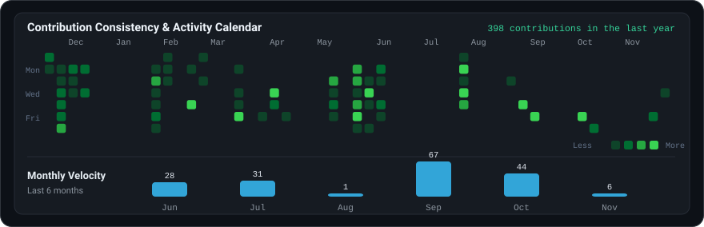

  

  &nbsp;&nbsp;
  &nbsp;&nbsp;
  &nbsp;&nbsp;
  &nbsp;&nbsp;
  &nbsp;&nbsp;
  &nbsp;&nbsp;
  &nbsp;&nbsp;
  &nbsp;&nbsp;
  

---

## About

I'm **Prajeen S**, an Electronics and Communication Engineering student at **Sri Eshwar College of Engineering** (`Class of 2028`, `CGPA: 8.12`). I write full-stack TypeScript and Python systems, build hardware-software robotics prototypes, and solve algorithmic problems daily across competitive programming platforms.

---

## Experience

**MERN Stack Intern — AlgoTutor**
- Built a full-stack subscription tracking platform (`MongoDB`, `Express.js`, `React`, `Node.js`).
- Implemented JWT authentication, role-guarded REST endpoints, and production deployment workflows.

---

## Tech Stack

| Category | Proficient | Exploring |
| :--- | :--- | :--- |
| **Languages** | `C` `C++` `Java` `Python` `TypeScript` `JavaScript` `SQL` | — |
| **Web Development** | `React.js` `HTML5` `CSS3` `Tailwind CSS` `Chart.js` | Advanced React State Architecture |
| **Backend** | `Node.js` `Express.js` `Django` `DRF` `REST APIs` `JWT` | Event-Driven Microservices |
| **Databases** | `PostgreSQL` `MongoDB` `SQLite` | Query Tuning & Indexing |
| **Data Engineering** | `Pandas` `Matplotlib` `ReportLab` `Python ETL` | Real-Time Telemetry Pipelines |
| **Cloud & DevOps** | `Docker` `Vercel` `Render` `Netlify` `Linux (RHSA)` | Automated CI/CD Pipelines |
| **Tools & Embedded** | `Git` `GitHub` `VS Code` `PyQt5` `Arduino Uno R4` `Raspberry Pi 5` `ESP32` | Multi-Agent AI Workflows |

---

## Selected Projects

| Project | Stack | Description | Links |
| :--- | :--- | :--- | :--- |
| **ECE Connect** | `TypeScript` `Python` `Docker` | Departmental platform with role-based KPIs, hackathon tracking, and automated data pipelines. | [Repo](https://github.com/PRAJEENS2024/ECE-Connect) |
| **Cold Chain Monitoring** | `TypeScript` `Python` `Docker` | Containerized cold-chain logistics telemetry suite with live monitoring and alerting. | [Repo](https://github.com/PRAJEENS2024/Cold_Chain_Monitoring) · [Live](https://cold-chain-monitoring-pi.vercel.app) |
| **AI Jury** | `TypeScript` `Python` | Multi-agent deliberation pipeline chaining 7 specialized agents for critique and fact verification. | [Repo](https://github.com/PRAJEENS2024/Multi-AI-Deliberation-Agent) |
| **ChemSight** | `Python` `DRF` `React` `PyQt5` | Hybrid Web + Desktop chemical equipment analytics tool with CSV ingestion and PDF/Excel export. | [Repo](https://github.com/PRAJEENS2024/fossee-semester-intern-2026) |
| **Billora** | `MongoDB` `Express` `React` `Node` | Subscription & recurring expense manager with category analytics and pause/resume controls. | [Repo](https://github.com/PRAJEENS2024/Billora-App) · [Live](https://billora-app-five.vercel.app) |
| **Autonomous Rover** | `Arduino R4` `RPi 5` `ESP32` `LiDAR` | Autonomous terrain mapping, obstacle detection, and path planning rover. | — |

---

## Achievements & Certifications

**Competitions**
- **Third Prize** — Mini Project Expo 2026
- **Semi-Finalist** — Caterpillar Autonomy Challenge 2024 & 2025
- **2nd Runner Up** — Freshathon 2025
- **Shortlisted** — SICPC Continental Round 2025 & SAP Hackfest Regional Round 2025

**Certifications**
- NPTEL Design Thinking *(Elite Silver)* · NPTEL Introduction to IoT *(Elite Silver)*
- Red Hat System Administration · MERN Stack Full Stack Development
- Mastering DSA using C & C++ · SQL for Beginners · HackerRank Certified *(SQL, Java)*

---

## GitHub Telemetry

<!-- AUTO-GENERATED-START: github-stats -->

  

  

Source: GitHub GraphQL API · Last data change: 2026-11-26

<!-- AUTO-GENERATED-END: github-stats -->

---

## Coding Profiles

<!-- AUTO-GENERATED-START: coding-stats -->

  

  <strong>Verified Solved Total:</strong> <code>2,698+</code>  
  &nbsp;&nbsp;
  &nbsp;&nbsp;
  &nbsp;&nbsp;
  &nbsp;&nbsp;
  

LeetCode, SkillRack, CodeChef, and HackerRank sync automatically. GeeksforGeeks renders client-side without a public API, so its logo links directly to the live profile.

<!-- AUTO-GENERATED-END: coding-stats -->

---

## Recent Activity

<!-- AUTO-GENERATED-START: activity -->
#### Recent GitHub Activity

| Date | Repository | Event |
| :--- | :--- | :--- |
| `2026-11-25` | [PRAJEENS2024](https://github.com/PRAJEENS2024/PRAJEENS2024) | Pushed updates |
| `2026-11-20` | [ECE-Connect](https://github.com/PRAJEENS2024/ECE-Connect) | Pushed updates |

#### Recent LeetCode Accepted

| Date | Problem |
| :--- | :--- |
| `2026-11-26` | [Make The String Great](https://leetcode.com/problems/make-the-string-great/) |
| `2026-11-26` | [Stone Removal Game](https://leetcode.com/problems/stone-removal-game/) |
| `2026-11-25` | [Replace Words](https://leetcode.com/problems/replace-words/) |
| `2026-11-25` | [Minimum Sum of Squared Difference](https://leetcode.com/problems/minimum-sum-of-squared-difference/) |
| `2026-11-25` | [Zigzag Conversion](https://leetcode.com/problems/zigzag-conversion/) |
<!-- AUTO-GENERATED-END: activity -->

---

  Synced automatically every day at 06:00 PM IST via <a href="./.github/workflows/update-readme.yml">GitHub Actions</a> · <a href="./AUTOMATION.md">Automation Docs</a>

