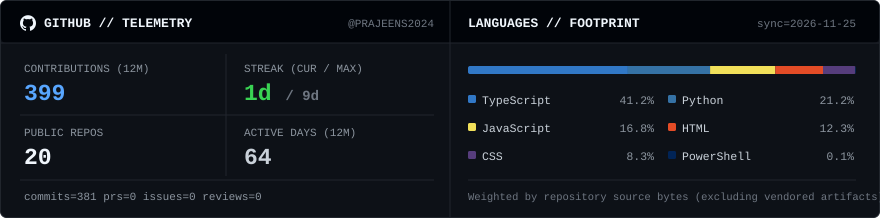
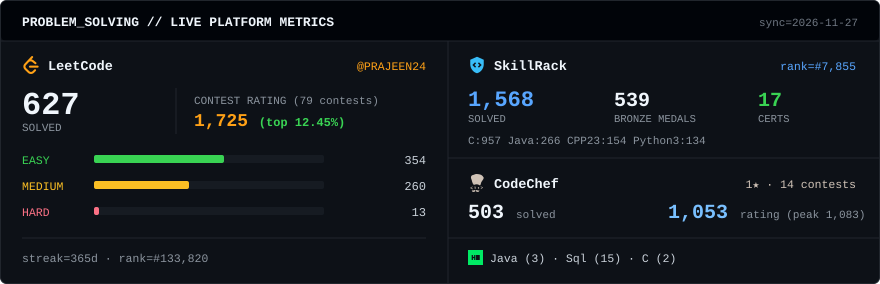

  

  
  
  
  
  

---

### About Me

I am **Prajeen S**, an **Electronics and Communication Engineering** undergraduate at **Sri Eshwar College of Engineering** (Class of 2028 · CGPA: `8.12`), engineering full-stack web platforms, multi-agent AI pipelines, and hardware-integrated IoT & robotics systems.

- **Engineering Focus:** Designing production-ready TypeScript/React frontends backed by scalable Node.js, Express, and Django REST architectures.
- **Current Exploration:** Multi-agent AI deliberation systems, containerized Docker deployments, and algorithmic problem solving across graphs & dynamic programming.
- **Prior Experience:** Former **MERN Stack Intern at AlgoTutor**, where I built and shipped full-stack subscription software with secure REST APIs.

---

### Experience & Recognition

<table>
<tr>
<td width="50%" valign="top">

#### Experience
**MERN Stack Intern — AlgoTutor**
- Engineered a full-stack Subscription Tracking Application using MongoDB, Express.js, React, and Node.js.
- Implemented stateless **JWT Authentication** and role-safe access control.
- Designed, documented, and deployed secure RESTful APIs across the release lifecycle.

</td>
<td width="50%" valign="top">

#### Hackathons & Competitions
- **Third Prize** — Mini Project Expo 2026
- **Semi-Finalist** — Caterpillar Autonomy Challenge 2024 & 2025
- **2nd Runner Up** — Freshathon 2025
- **Shortlisted** — SICPC Continental Round 2025
- **Shortlisted** — SAP Hackfest Regional Round 2025

</td>
</tr>
</table>

<strong>Certifications & Verified Credentials</strong>

- **NPTEL Design Thinking** — Elite Silver
- **NPTEL Introduction to Internet of Things (IoT)** — Elite Silver
- **Red Hat System Administration**
- **MERN Stack Full Stack Development**
- **Mastering Data Structures & Algorithms using C & C++**
- **SQL for Beginners** & **Basics of C, C++, Java, and Python**
- **HackerRank Certified** — SQL & Java

---

### Technical Stack

| Domain | Core Proficiency | Currently Exploring |
| :--- | :--- | :--- |
| **Programming Languages** | `C` · `C++` · `Java` · `Python` · `TypeScript` · `JavaScript` · `SQL` | — |
| **Web Development** | `React.js` · `HTML5` · `CSS3` · `Tailwind CSS` · `Chart.js` | Advanced React State Patterns |
| **Backend Development** | `Node.js` · `Express.js` · `Django` · `Django REST Framework` · `JWT` · `REST APIs` | Microservices & Event-Driven APIs |
| **Databases** | `PostgreSQL` · `MongoDB` · `SQLite` | Query Optimization & Indexing |
| **Data Engineering** | `Pandas` · `Matplotlib` · `ReportLab` · `Python ETL Pipelines` | Automated Telemetry Pipelines |
| **Cloud & DevOps** | `Docker` · `Vercel` · `Render` · `Netlify` · `Linux (RHSA)` | Multi-Container CI/CD Workflows |
| **Developer Tools & Embedded** | `Git` · `GitHub` · `VS Code` · `PyQt5` · `Arduino Uno R4` · `Raspberry Pi 5` · `ESP32` | Multi-Agent AI Orchestration |

---

### Featured Projects

<table>
  <tr>
    <td width="50%" valign="top">
      <h4>ECE Connect — Departmental OS &amp; Engagement Platform</h4>
      
Full-stack departmental platform for students, faculty, and HOD leadership featuring role-based KPI dashboards, hackathon/achievement tracking, and automated data pipelines.

      
<code>TypeScript</code> <code>Python</code> <code>Docker</code> <code>Data Pipeline</code>

      
<a href="https://github.com/PRAJEENS2024/ECE-Connect">Repository</a>

    </td>
    <td width="50%" valign="top">
      <h4>Cold Chain Monitoring — Real-Time Telemetry Suite</h4>
      
Containerized monitoring platform tracking temperature-sensitive cold-chain logistics with real-time alerts, cloud-hosted backend services, and a live web dashboard.

      
<code>TypeScript</code> <code>Python</code> <code>Docker</code> <code>Vercel</code> <code>Render</code>

      
<a href="https://github.com/PRAJEENS2024/Cold_Chain_Monitoring">Repository</a> · <a href="https://cold-chain-monitoring-pi.vercel.app">Live Demo</a>

    </td>
  </tr>
  <tr>
    <td width="50%" valign="top">
      <h4>AI Jury — Multi-AI Deliberation Agent</h4>
      
Enterprise deliberation platform orchestrating 7 specialized AI agents (research, critic, fact-checker, bias detector, synthesizer) in a structured consensus pipeline.

      
<code>TypeScript</code> <code>Python</code> <code>Multi-Agent AI</code> <code>REST APIs</code>

      
<a href="https://github.com/PRAJEENS2024/Multi-AI-Deliberation-Agent">Repository</a>

    </td>
    <td width="50%" valign="top">
      <h4>ChemSight — Hybrid Chemical Analytics Visualizer</h4>
      
Synchronized React Web and PyQt5 Desktop industrial analytics suite powered by a unified Django REST API for CSV ingestion, charting, and PDF/Excel reporting.

      
<code>Python</code> <code>Django REST</code> <code>React</code> <code>PyQt5</code> <code>Pandas</code>

      
<a href="https://github.com/PRAJEENS2024/fossee-semester-intern-2026">Repository</a>

    </td>
  </tr>
  <tr>
    <td width="50%" valign="top">
      <h4>Billora — Full-Stack Subscription Manager</h4>
      
MERN application for tracking recurring subscriptions, pausing billing cycles, and analyzing category spending with interactive charts and dark/light themes.

      
<code>MongoDB</code> <code>Express.js</code> <code>React</code> <code>Node.js</code>

      
<a href="https://github.com/PRAJEENS2024/Billora-App">Repository</a> · <a href="https://billora-app-five.vercel.app">Live Demo</a>

    </td>
    <td width="50%" valign="top">
      <h4>Autonomous Rover — Smart Terrain Navigator</h4>
      
Robotics flagship built for Caterpillar Autonomy Challenge &amp; Mini Project Expo, integrating LiDAR sensing, obstacle detection, and dynamic path planning.

      
<code>Arduino Uno R4</code> <code>Raspberry Pi 5</code> <code>ESP32</code> <code>LiDAR</code>

      
<em>Caterpillar Autonomy Challenge Semi-Finalist</em>

    </td>
  </tr>
</table>

---

### GitHub Engineering Analytics

<!-- AUTO-GENERATED-START: github-stats -->

  

  

Source: GitHub GraphQL API · Last synced on 2026-11-25

<!-- AUTO-GENERATED-END: github-stats -->

---

### Competitive Programming & Problem Solving

<!-- AUTO-GENERATED-START: coding-stats -->

  

  <strong>Verified Cross-Platform Total:</strong> <code>2,694+</code> problems solved · 
  <a href="https://leetcode.com/u/PRAJEEN24">LeetCode</a> · 
  <a href="https://www.skillrack.com/faces/resume.xhtml?id=515303&amp;key=3742f907d9a4a34167e0c70e8dfe04481e54470b">SkillRack</a> · 
  <a href="https://www.codechef.com/users/prajeens">CodeChef</a> · 
  <a href="https://www.hackerrank.com/profile/prajeensenthilk1">HackerRank</a> · 
  <a href="https://www.geeksforgeeks.org/profile/prajeensenti9s7">GeeksforGeeks</a>

Note: LeetCode, SkillRack, CodeChef, and HackerRank metrics sync automatically via live APIs/profiles. GeeksforGeeks renders stats client-side without a public unauthenticated API, so it is linked directly without stale numbers.

<!-- AUTO-GENERATED-END: coding-stats -->

---

### Recent Engineering Activity

<!-- AUTO-GENERATED-START: activity -->
<table>
<tr>
<td width="50%" valign="top">

#### Recent GitHub Activity

| Date | Repository | Event |
| :--- | :--- | :--- |
| `2026-11-20` | [ECE-Connect](https://github.com/PRAJEENS2024/ECE-Connect) | Pushed updates |

</td>
<td width="50%" valign="top">

#### Recent LeetCode Accepted

| Date | Problem |
| :--- | :--- |
| `2026-11-25` | [Minimum Sum of Squared Difference](https://leetcode.com/problems/minimum-sum-of-squared-difference/) |
| `2026-11-25` | [Zigzag Conversion](https://leetcode.com/problems/zigzag-conversion/) |
| `2026-11-24` | [Maximum Subarray With Equal Products](https://leetcode.com/problems/maximum-subarray-with-equal-products/) |
| `2026-11-23` | [Bank Account Summary II](https://leetcode.com/problems/bank-account-summary-ii/) |
| `2026-11-23` | [Product of the Last K Numbers](https://leetcode.com/problems/product-of-the-last-k-numbers/) |

</td>
</tr>
</table>
<!-- AUTO-GENERATED-END: activity -->

---

  Automated daily via <a href="./.github/workflows/update-readme.yml">GitHub Actions</a> · Architecture &amp; setup documented in <a href="./AUTOMATION.md">AUTOMATION.md</a>

